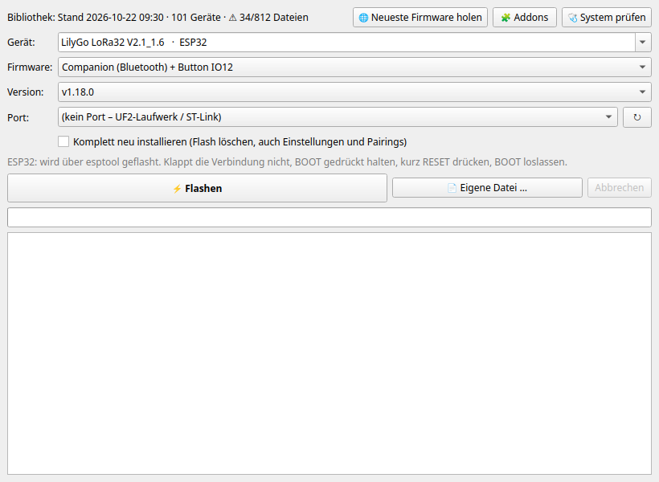
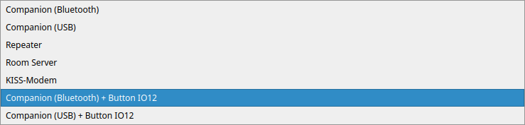
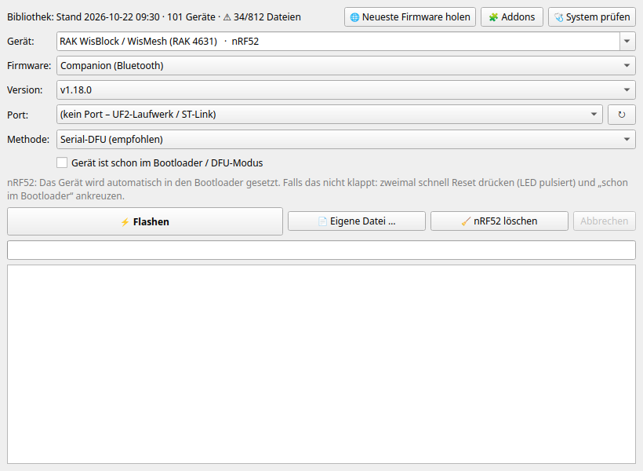
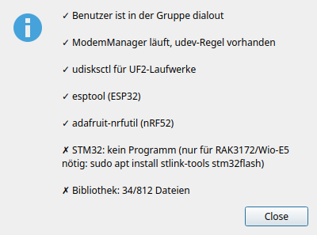

# MeshCore Flasher

Linux-Werkzeug zum Flashen von [MeshCore](https://github.com/meshcore-dev/MeshCore)-Firmware
auf LoRa-Geräte: ESP32 (Heltec, LilyGo, Xiao S3 …), nRF52 (RAK4631, T-Echo, T114,
T1000-E …), RP2040 und STM32 (RAK3172, Wio-E5). Die Firmware wird auf Knopfdruck
aus dem Internet geholt und lokal gespeichert. Danach funktioniert das Flashen
komplett offline.



> [!WARNING]
> **Erprobungsstand.** Die Software ist neu und erst an wenigen echten Geräten
> getestet. Rechne mit Fehlern.
>
> **Ein Firmware-Update oder -Upgrade kann ein Gerät unbrauchbar machen
> („bricken“).** Das gilt besonders bei Abbrüchen während des Schreibens, falscher
> Geräteauswahl, „Komplett neu installieren“ und selbst gebauten Addons. Meist lässt
> sich ein Gerät über den Bootloader retten, aber nicht immer.
>
> **Die Nutzung erfolgt auf eigene Verantwortung.** Es gibt keine Gewährleistung und
> keine Haftung für Schäden an Geräten, verlorene Einstellungen, Schlüssel oder
> Kontakte (siehe [Lizenz](#lizenz), Abschnitte 15 und 16 der GPL).

> [!NOTE]
> **Von einer KI geschrieben.** Der Code und diese Anleitung wurden mit
> Claude (Anthropic) erstellt, unter Anleitung und mit Tests durch einen Menschen.
> Der Code wurde nicht unabhängig geprüft. Wer ihn für Wichtiges einsetzt, sollte
> ihn vorher selbst lesen.

## Was es kann

- **Offline flashen**: Geräteliste und Firmware liegen lokal, Internet ist nur
  zum Aktualisieren nötig.
- **Neueste Firmware nur auf Knopfdruck**: Der Flasher geht nie von selbst ins
  Internet. Jede Datei wird gegen die SHA-256-Prüfsumme von GitHub geprüft.
- **Alle Gerätetypen** aus [flasher.meshcore.io](https://flasher.meshcore.io) plus
  weitere Boards aus den Release-Dateien (mit `*` markiert).
- **Sicherheitsprüfungen vor dem Schreiben**: Der Chip im Image muss zum Gerät
  passen (ESP32/S3/C3 …, nRF52 vs. RP2040 bei UF2), sonst wird nichts geschrieben.
- **Port-Erkennung**: Angesteckte Geräte werden erkannt, und der Flasher merkt sich,
  was zuletzt auf welches Gerät kam.
- **Addons**: eigene Patches auf offizielle Releases, z. B. ein umgelegter Button.
- Oberfläche (PyQt6) und Kommandozeile.

| Firmware-Auswahl inkl. Addons | nRF52-Gerät |
|---|---|
|  |  |

## Installation

### .deb-Paket (Debian 12+, Ubuntu 24.04+, Raspberry Pi OS 64 Bit)

Das Paket von der [Releases-Seite](../../releases) laden (`amd64` für PCs, `arm64`
für Raspberry Pi) und installieren:

```bash
sudo apt install ./meshcore-flasher_*_amd64.deb
sudo usermod -aG dialout $USER     # Zugriff auf serielle Ports, danach neu anmelden
```

Das Paket bringt esptool und adafruit-nrfutil mit und braucht zur Installation
kein Internet (außer für Abhängigkeiten wie `python3-pyqt6`, falls die noch fehlen).
Es installiert auch die udev-Regel gegen ModemManager. Gestartet wird über das
Anwendungsmenü oder `meshcore-flasher`. Bibliothek und Addon-Builds liegen in
`~/.local/share/meshcore-flasher/`.

### Aus dem Quellcode

```bash
git clone https://github.com/FelixLenz-Code/meshcore-flasher.git
cd meshcore-flasher
sudo apt install python3-venv python3-pyqt6 udisks2
./install.sh          # venv, Menüeintrag, udev-Regel (fragt nach sudo)
./meshcore-flasher    # Oberfläche, mit Argumenten: Kommandozeile
```

Ohne Internet: Liegt ein Ordner `wheels/` daneben (`packaging/fetch-wheels.sh
wheels`), installiert `install.sh` daraus. Bibliothek und Builds liegen dann im
Projektordner unter `library/`.

## Benutzung

### 1. Firmware holen (einmal mit Internet)

**🌐 Neueste Firmware holen** bzw. `meshcore-flasher sync` lädt die Geräteliste und
die neueste Version jeder Rolle (Companion BLE/USB, Repeater, Room Server,
KISS-Modem).

- Abgebrochene oder kaputte Downloads landen nie in der Bibliothek, vorhandene
  Dateien werden übersprungen.
- Ältere, schon heruntergeladene Versionen bleiben auswählbar.
- Alle Geräte zusammen sind etwa 600 MB. Nur einzelne Geräte: In der Oberfläche
  „Nein“ wählen (nur das gewählte Gerät), oder `sync -d "Heltec v3" -d "RAK 4631"`.

### 2. Flashen

1. Gerät per USB anstecken. Der Port wird automatisch ausgewählt.
2. Gerät, Firmware und Version wählen, **⚡ Flashen**.

| Typ | Ablauf | Wenn es nicht klappt |
|---|---|---|
| ESP32 | esptool, Update ab 0x10000, Einstellungen bleiben | BOOT halten, RESET drücken, BOOT loslassen |
| ESP32 + „Komplett neu“ | Flash löschen + `-merged.bin` ab 0x0 | auch Schlüssel und Pairings sind danach weg |
| nRF52 | 1200-Baud-Reset, dann Serial-DFU mit dem `.zip` | Doppelklick Reset, „schon im Bootloader“ ankreuzen, oder Methode UF2 |
| nRF52 UF2 | `.uf2` aufs Bootloader-Laufwerk (wird selbst eingehängt) | Doppelklick Reset |
| RP2040 | `.uf2` aufs Laufwerk RPI-RP2 | BOOTSEL halten und anstecken |
| STM32 | ST-Link (`st-flash`) oder UART (`stm32flash`) | `sudo apt install stlink-tools stm32flash` |

**📄 Eigene Datei …** flasht selbst gebaute Firmware (`.bin`, `-merged.bin`, `.zip`,
`.uf2`, `.hex`). **🧹 nRF52 löschen** flasht die offizielle Lösch-Firmware, wenn ein
nRF52-Gerät nach einem Update hängt.

**Vor einem Update:** Wichtige Einstellungen und vor allem den privaten Schlüssel
(Companion-App, Export) sichern. Während des Flashens das Kabel nicht ziehen.

### Kommandozeile

```bash
meshcore-flasher sync                       # alles holen (Internet)
meshcore-flasher list heltec                # Geräte + Versionen in der Bibliothek
meshcore-flasher ports                      # angeschlossene Geräte
meshcore-flasher flash "LoRa32 V2.1" ble -p /dev/ttyUSB0
meshcore-flasher flash "Heltec v3" repeater -p /dev/ttyUSB0 -p /dev/ttyUSB1   # mehrere nacheinander
meshcore-flasher flash "RAK 4631" usb -p /dev/ttyACM0 --uf2
meshcore-flasher flash "Heltec v3" ble -p /dev/ttyUSB0 --wipe
meshcore-flasher file firmware.bin -p /dev/ttyUSB0
meshcore-flasher flash "LoRa32 V2.1" ble+io12 -p /dev/ttyUSB0   # Addon-Build
meshcore-flasher addons list | build | setup
meshcore-flasher doctor [--fix]             # System prüfen / udev-Regel einrichten
```

Rollen: `ble`, `usb`, `repeater`, `room`, `kiss`, Addon-Builds als `<rolle>+<addon>`.

## Addons (eigene Patches)

Ein Addon ist ein eigener Patch auf eine offizielle MeshCore-Release. Der Flasher
baut ihn einmal mit PlatformIO, danach steht er als eigene Firmware zur Auswahl und
wird offline geflasht wie alles andere.

Mitgeliefert: `addons/tlora-v2_1-button-io12`. Beim LilyGo LoRa32 V2.1_1.6 liegt der
User-Button auf IO12 statt auf BOOT (IO0), mit internem Pull-up. Das gilt für
Companion Bluetooth und USB.

- Einmalig PlatformIO installieren (Internet): `meshcore-flasher addons setup`.
- **🧩 Addons** bzw. `meshcore-flasher addons build` baut alle Addons, die älter sind
  als die neueste Release. Nach „Neueste Firmware holen“ weist der Flasher darauf hin.
- Passt ein Patch nach einem Update nicht mehr, bricht der Build mit einer klaren
  Meldung ab. Ältere Builds bleiben flashbar.
- Die Firmware meldet sich mit einer Version wie `v1.18.0-81dbae5+io12`.

Eigenes Addon: im MeshCore-Quellcode ändern, `git diff > <addons>/<name>/patch.diff`
und eine `addon.json` nach dem Vorbild anlegen. Eigene Addons gehören nach
`addons/` im Projektordner bzw. beim .deb nach
`~/.local/share/meshcore-flasher/addons/`. Selbst gebaute Firmware ist nicht
offiziell getestet, das Brick-Risiko ist hier höher.

## Wenn es nicht klappt

**🩺 System prüfen** bzw. `meshcore-flasher doctor` prüft die typischen Fallen:



- **Kein Zugriff auf den Port:** `sudo usermod -aG dialout $USER`, danach neu anmelden.
- **ModemManager** fragt neue `ttyACM`-Geräte als Modem ab und stört damit die
  nRF52-DFU. Eine udev-Regel nimmt MeshCore-Boards davon aus. Das .deb und
  `install.sh` richten sie ein. Fehlt sie, fragt die Oberfläche beim Start nach.
  Später geht es über **System prüfen → Jetzt beheben** oder `doctor --fix`.
- **brltty** (Ubuntu) schnappt sich CH340-Adapter, dann erscheint kein `/dev/ttyUSB*`.
  Abhilfe: `sudo apt remove brltty`.
- **Port belegt:** Ein MeshCore-Client oder ein serieller Monitor hat den Port offen.

Fehler bitte als [Issue](../../issues) melden, mit Gerät, Firmware, der Ausgabe
von `meshcore-flasher doctor` und dem Log.

## Aufbau

| Datei | Inhalt |
|---|---|
| `mcflash/catalog.py` | Bibliothek: Sync von flasher.meshcore.io/GitHub, Prüfsummen, Katalog |
| `mcflash/flasher.py` | Flash-Abläufe ESP32/nRF52/UF2/STM32, Image-Prüfungen |
| `mcflash/nrfdfu.py` | Serial-DFU über adafruit-nrfutil mit Fortschrittsanzeige |
| `mcflash/ports.py` | Port-Erkennung, 1200-Baud-Reset, Bootloader-Port finden |
| `mcflash/gui.py` / `cli.py` | Oberfläche (PyQt6) / Kommandozeile |
| `mcflash/addons.py` | Addons bauen (git + PlatformIO) und registrieren |
| `mcflash/doctor.py` | Systemprüfung, udev-Regel |
| `mcflash/paths.py` | Datenablage (Projektordner bzw. `~/.local/share` beim .deb) |
| `addons/` | Addon-Definitionen: `addon.json` + `patch.diff` |
| `packaging/` | .deb-Bau (`build-deb.sh`) und Offline-Wheels (`fetch-wheels.sh`) |

Ein neues Release entsteht durch einen Tag `vX.Y.Z`, der zu `__version__` in
`mcflash/__init__.py` passt. Die GitHub Action baut dann die .deb-Pakete für amd64
und arm64, testet die Installation und hängt sie an das Release.

## Lizenz

[GPL-3.0-or-later](LICENSE). Die GPL passt zu den verwendeten Bausteinen: PyQt6
(GPL-3.0), esptool (GPL-2.0-or-later), adafruit-nrfutil (BSD-artig) und
MeshCore (MIT). Die Firmware selbst wird nicht mitgeliefert, sondern von den
offiziellen MeshCore-Releases geladen und steht unter deren Lizenz.

Dieses Projekt ist kein offizielles MeshCore-Projekt und steht in keiner
Verbindung zu den MeshCore-Entwicklern oder den Geräteherstellern.
